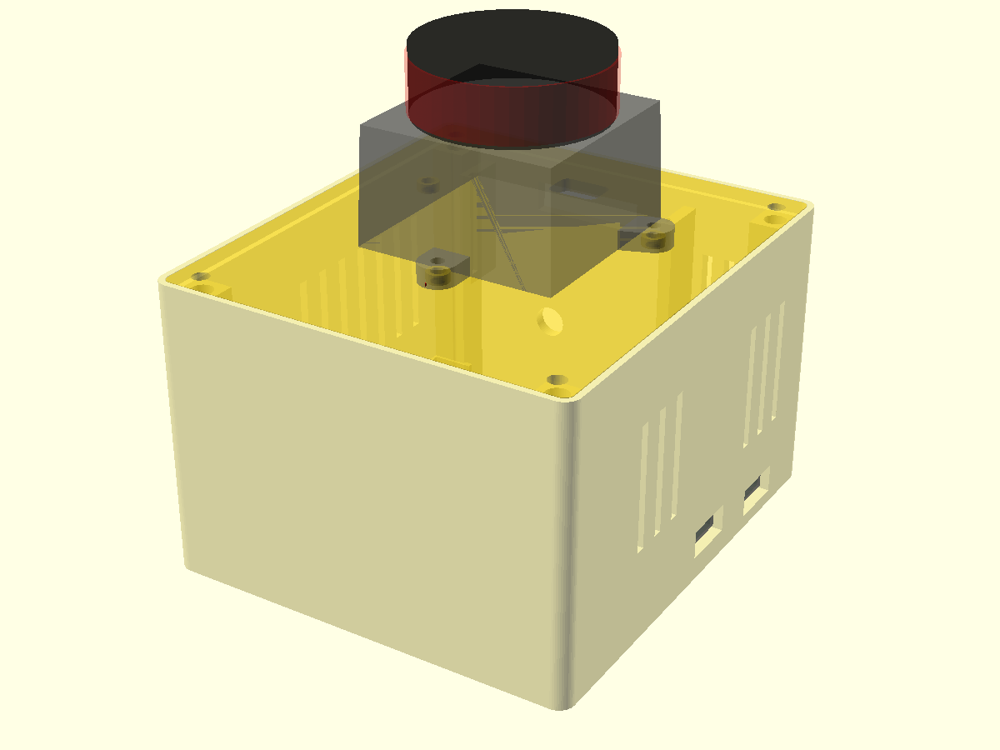

# Enclosures

## v1 parts (original author, print-ready)

Binary STL exports from Autodesk Fusion; bounding boxes measured from the files.
They fit the **Level 1** radar node and the GIGA display.

| File | Bounding box (mm) | Holds |
|---|---|---|
| `body display.stl` | 34 × 105 × 113 | GIGA R1 + Display Shield + 1160100 LiPo |
| `top display.stl` | 8 × 85 × 111 | display lid |
| `top radarmodule.stl` | 47 × 31 × 87 | XIAO + RD-03D + 602560 LiPo |
| `bottom radarmodule.stl` | 47 × 6 × 67 | radar node base plate |

Triangle counts are low (208–1088), so curved features print faceted. The GIGA
board is 101.5 mm long inside a 105 mm body: check the fit in your slicer.

## Level 2 sensor node (parametric OpenSCAD, designed from datasheets, not yet printed)

`level2_sensor_node.scad` is the box for the radar + LIDAR node: the RD-03D
stands upright inside the front wall behind a thin radar window, the LD19 bolts
onto the lid on its three mounting ears, and the XIAO ESP32-S3, the MT3608 boost
module, the TP4056 charger, the pouch cell, the toggle switch and the 4-LED
battery indicator sit inside. With the default 103450 cell the box is
80.8 × 89.8 × 56.5 mm outside (76 × 85 × 52 mm inside) and 91.3 mm tall with
the LD19 on top; the box grows automatically with a larger cell.



The model has not been printed yet. What is known and what is not:

| Part | Number used | Source | Status |
|---|---|---|---|
| LD19 base | 38.59 mm square at the mounting plane, rotation axis at its centre, 2° draft; 34.8 mm high; cap Ø35.29 × 12.6 | LDROBOT LD19 datasheet V1.0 installation drawing (±0.2 mm); STEP model of the identical STL-19P | verified |
| LD19 mounting | three ears: Ø2.5 through holes with a Ø4.46 × 2 mm counterbore on the underside at (±23.40, +8.52) and (0, −23.40) from the rotation axis, +y toward the connector; ears reach ±27.0 (54 mm) and −27.0 | same drawing (46.80 and 31.92 mm between holes) and both STEP models | verified; the lid's holes are checked numerically against this pattern after every render |
| LD19 connector | ZH1.5T-4P socket centred low in the +y wall, 2.9–7.3 mm above the mounting plane, cable leaving horizontally | STEP model | verified |
| LD19 optical band | 23–33 mm above the mounting plane, all round | datasheet optical-window drawing | verified; nothing on the lid rises above 4.8 mm |
| LD19 zero direction | through the single rear ear, away from the connector; clockwise seen from above | datasheet coordinate figure | verified from the figure, confirm on hardware |
| RD-03D board | 15.0 × 44.0 mm (±0.2), R2.0 corners on one diagonal, R1.1 notches on the other, no mounting holes; J1 1.25 mm wafer on the back at one short end, J2 pads along one long edge at the other end; antenna patches on the front, two thirds of it nearest J2 | Ai-Thinker Rd-03D specification V1.0.0 Table 1 and Figure 4, user manual Figure 8-1 | verified; PCB thickness (1.6 assumed) and J1 height (4.5 allowed, a user measured 3.8) are not published |
| RD-03D posture | 44 mm axis vertical, antenna toward the room, connector end down: the ±60° azimuth field opens across the 15 mm width | user manual section 9.1, posture (a) | verified |
| Radar window | 1.0 mm wall, 0.8 mm air gap to the antenna face, 24 × 50 mm pane, no metal within 20 mm | ICLEGEND radome rules as printed in the HLK-LD2450 manual (same 24 GHz front end): wall ≤ λ/8 in plastic or a half wave (ABS 3.92 mm), gap ≤ λ/10 or multiples of 6.2 mm; a 3.1 mm gap is the worst case | design rule, not an Ai-Thinker number |
| XIAO ESP32-S3 | 21.135 × 17.78 mm, R1.905, USB-C overhanging 1.5 mm, battery pads on the back | Seeed's published KiCad design | verified outline; component heights assumed |
| MT3608 module | 37.2 × 17.2 × 14 mm, no mounting holes | seller listings, NopSCADlib measured model | MEASURE |
| TP4056 USB-C module | 28 × 17.3 × 4.9 mm, port overhanging 1.5 mm | seller listings | MEASURE |
| 1S 4-LED indicator | 43.5 × 20 × 8.6 mm | seller listings | MEASURE |
| Pouch cells | 103450 = 10 × 34 × 50 (1800–2000 mAh), 105575 = 10 × 55 × 75 (5000 mAh), 606090 = 6 × 60 × 90 (4000 mAh), 906090 = 9 × 60.5 × 92 (6000 mAh) | Jauch and DNK datasheets, listings | medium confidence; select with `cell_type` |
| M3 heat-set inserts | 4.2 mm pilot hole in the four corner posts (4.0 nominal, printed holes come out ~0.25 undersize) | CNC Kitchen and Accu charts | design rule |

Every number in the `.scad` file carries a comment naming its source. The lid
holds the LD19 with M2.5 × 8 screws from above and M2.5 nuts in hexagonal
pockets under the lid; Ø4.2 × 1.8 mm bosses on the lid fit the ears' counterbores
so the sensor locates itself. The lid is held by four M3 × 8 screws in the inserts.
The LD19's rear ear (its 0° direction) points to the front of the box, the
radar's direction, and its connector wall points to the back, where a slot
through the lid takes the cable; `LIDAR_ANGLE_OFFSET_DEG` therefore starts near 0.

`assert()` statements abort the render when a parameter breaks a rule: the
window thicker than 1.3 mm, the antenna gap over 1.25 mm, a part pocket outside
the cavity or overlapping another, the cell or the switch inside the 20 mm
keep-out in front of the antenna, the LD19 footprint off the lid, the cable
slot touching a mounting hole, or anything on the lid reaching the optical band.

### Print order

1. Print the paper template first: export `level2_ld19_template.svg` (already
   in this folder) at 100 % and lay the LD19 on it. The three hole crosshairs,
   the body outline and the connector mark must line up. A 20 mm scale bar on
   the sheet shows whether the printer scaled the page.
2. Print `level2_ld19_coupon.stl` (a 60 × 60 × 2.5 mm plate with exactly the
   lid's holes, bosses, nut pockets and cable slot; about ten minutes). The
   sensor must sit on the three bosses without rocking and the M2.5 screws must
   pass freely.
3. Print `level2_rd03d_coupon.stl` (a 30 mm slice of the front wall with the
   window and the cradle rails). The radar board must slide into the grooves
   from the top with light friction and the 1.0 mm window must print solid.
4. Measure your MT3608, TP4056, indicator board and cell, put the numbers into
   the parameters marked MEASURE, render the base and lid, and check the
   assembly view (`part="assembly"`, the ghosts show every part in place).
5. Print `level2_sensor_node_lid.stl` and `level2_sensor_node_base.stl`.

### Print settings

PETG or ABS for the base (the radar window should be a low-loss plastic; PLA
works too but check the range in the calibration walk). 0.2 mm layers, three
perimeters, and set the infill to 100 % for the first 2 mm of the front wall so
the window pane is solid; print the base with the open top up and the lid top
face up. No supports are needed: the only overhangs are the USB-C openings and
the vents, which bridge.

### Render

```bash
openscad -D 'part="base"'          -o level2_sensor_node_base.stl level2_sensor_node.scad
openscad -D 'part="lid"'           -o level2_sensor_node_lid.stl  level2_sensor_node.scad
openscad -D 'part="ld19_coupon"'   -o level2_ld19_coupon.stl      level2_sensor_node.scad
openscad -D 'part="rd03d_coupon"'  -o level2_rd03d_coupon.stl     level2_sensor_node.scad
openscad -D 'part="ld19_template"' -o level2_ld19_template.svg    level2_sensor_node.scad
openscad -D 'part="base"' -D 'cell_type="606090"' -o base_606090.stl level2_sensor_node.scad   # bigger cell
```

Open the file in OpenSCAD with `part="assembly"` to see the base, the lid, the
LD19 with its optical band, the radar board and the other parts together;
`level2_lid_preview.png` shows the lid from above and `level2_base_preview.png`
the inside of the base.
