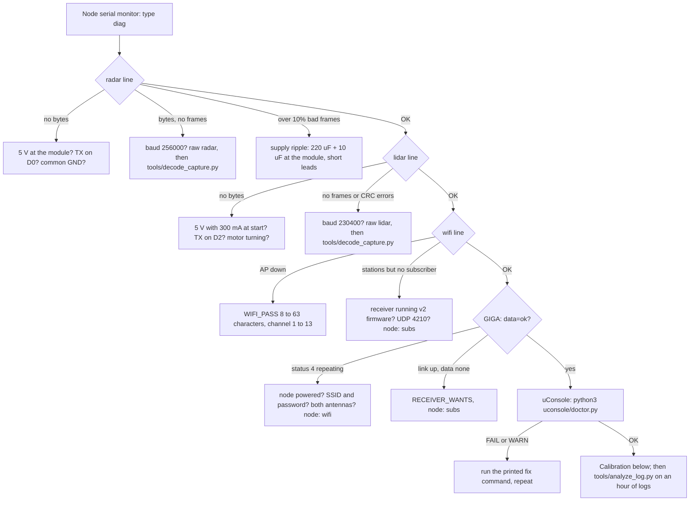

# Bring-up, testing and calibration

Work through this in order the first time. Every stage has an expected output,
so a radar wiring fault, a LIDAR fault and a Wi-Fi fault each look different.
Three helpers do most of the diagnosis for you: the node's own serial console
(type `diag`), `tools/analyze_log.py` for anything you saved, and
`uconsole/doctor.py` on the uConsole. The flowchart at the end ties them together.

## 0. Bench test the software without hardware

```bash
tools/check.sh                                   # everything below in one go (needs g++; firmware builds need arduino-cli)

cd uconsole
python3 -m unittest discover -s tests            # protocol bytes vs the C header, parsers vs the C++ headers,
                                                 # state, intrusion, relay loopback, the tools, doctor, installer
python3 fake_sensor_node.py &                    # simulated sensor node on UDP 4210
python3 radar_viewer.py --node 127.0.0.1 --windowed
```

You should see a 6 × 4 m rectangular room outline with a gap (a "doorway") and
one or two walkers in the radar sector, `DATA OK` in the HUD and roughly
`rx 70/s`. Quit with ESC, stop the fake node with `kill %1`.

The firmware's parsers, console parser and self-diagnosis run on your PC too:

```bash
g++ -std=c++11 -Wall -Wextra -Werror -I Firmware/sensor_node_esp32s3 Firmware/tests/host/test_parsers.cpp -o /tmp/t1 && /tmp/t1
g++ -std=c++11 -Wall -Wextra -Werror -I Firmware/sensor_node_esp32s3 Firmware/tests/host/test_node_logic.cpp -o /tmp/t2 && /tmp/t2
```

## 0b. Optional: test a sensor straight from the PC

If you own a USB-UART adapter you can prove a sensor works before it meets the
ESP32. Wire the sensor's TX to the adapter's RX (3.3 V logic on both), GND to
GND, and 5 V from a supply that can give 300 mA (the RD-03D needs 200 mA peaks,
the LD19 300 mA at start; many adapters' 5 V pins manage that, a phone charger
or the MT3608 always does). Then:

```bash
pip install pyserial                                                   # once (Debian: sudo apt install python3-serial)
python3 tools/sensor_probe.py --port /dev/ttyUSB0 --sensor radar --configure
python3 tools/sensor_probe.py --port /dev/ttyUSB0 --sensor lidar --seconds 10
```

Radar: one line per frame with the targets the node would forward (position,
range, speed) or `no target` when nothing moves, and with `--configure` the
module's replies to the three configuration commands (adapter TX to module RX
needed for that). LIDAR: once a second `lidar: 375 frames/s, 0 CRC errors,
speed field 3580..3620 deg/s, 18800 bytes so far`. Both end with the same summary and hints as
`decode_capture.py` below. `--save file.bin` keeps the raw bytes, `--hex`
prints them like the node does. Adapters known to do 256000 baud: CP2102,
CH340, FT232; the LD19's 230400 works everywhere.

## 1. Sensor node on USB power, radar only

Battery switch **off**, `ENABLE_LIDAR 0` for this step if you like, XIAO on USB,
serial monitor at 115200 baud. Expected:

```
RadarLink sensor node — RD-03D + LD19
radar UART1 rx=1 tx=2 @256000 | lidar UART2 rx=3 tx=4 @230400
[wifi] AP "RadarSystem" up on channel 6, IP 192.168.4.1, UDP port 4210
[boot] ready; waiting for receivers to say HELLO. Type ? for the serial console (diag, raw, subs, wifi)
[radar] multi-target mode configured
[stat] up=2s ap=up sta=0 subs=0 | radar fps=10 bytes=1234 bad=0 cfg=1 reconf=0 | lidar fps=0 pps=0 bytes=0 crc=0 speed=0 | heap=...
```

The RD-03D reports 10 frames per second (30 bytes each), so `radar fps=10` is
the healthy value. With the RD-03D powered from the boost converter (trimmed to
5.0 V first):

| What you see | Meaning |
|---|---|
| `radar fps=10 bad=0`, `bytes` growing | radar wired and configured. Normal. |
| `bytes` growing, `fps=0`, `bad=0` | framing never syncs: wrong baud (must be 256000), or TX/RX swapped so you read noise |
| `bytes` growing, `fps=0`, `bad` growing | headers found but every tail is wrong: bytes are being lost, or a different frame layout |
| `bytes=0` | no data at all: RD-03D not powered (needs 5 V, 3.3 V gives nothing), TX not on D0, or GND missing |
| `reconf` incrementing every 5 s | radar silent for 5 s each time; the node re-sends the mode command. Check the 5 V rail with a meter under load |

The LED blinks briefly every 0.5 s while no receiver is subscribed and every
2 s once one is.

### Ask the node: the serial console

Anything you type in the serial monitor (newline or carriage return ends a
line) is a command. `?` lists them:

```
commands: ? help | s stat | d diag | raw radar [N] | raw lidar [N] | subs | wifi | reconfig | log on|off | reboot
```

`diag` applies the tables above to the node's own counters and prints a verdict
per subsystem, for example:

```
[diag] OK   radar: 10 frames/s, 1203 frames, 0% bad, multi-target mode configured
[diag] FAIL lidar: no bytes received: LD19 not powered (5 V, 180 mA+), its TX not on D2/GPIO3, or no common ground. Is the motor turning?
[diag] INFO wifi: AP up, no receiver has joined: power the GIGA / connect the uConsole, check SSID and password, antenna plugged in?
[diag] INFO heap: 265 KB free, lowest 262 KB since boot
[diag] result: FAILURES, see above
```

When `diag` cannot tell what the bytes are, capture them: `raw radar` copies
the next 600 bytes (20 frames) from the radar UART into memory while the node
keeps running and prints them as hex, `raw lidar` does the same for 4700 bytes
(100 frames); `raw radar 2000` chooses the count. Copy everything from the
`capturing` line to `end` into a file and run

```bash
python3 tools/decode_capture.py capture.txt            # add --verbose for every frame
```

It decodes the frames exactly as the firmware does, lists the module's
configuration replies, and says whether the stream looks like a wrong baud
rate, an idle line, lost bytes or a module still in single-target mode.
`log off` stops the periodic `[stat]` lines while you copy; `subs` lists the
receivers, `wifi` the joined stations with their signal strength, `reconfig`
re-sends the radar's mode command, `reboot` restarts.

## 2. Add the LD19

Connect the LD19 (Tx → D2, P5V from the boost, GND common, PWM tied to GND). The motor
spins up within a second. Expected in `[stat]`:

```
lidar fps=370..380 pps=3500..4500 crc=0 speed=3500..3700
```

| What you see | Meaning |
|---|---|
| `fps≈375 crc=0` | good. `pps` is lower than 4500 when part of the room is beyond 12 m or absorbs the laser |
| `bytes` growing, `fps=0`, `crc=0` | wrong baud (must be 230400) or another device on that pin |
| `bytes` growing, `fps=0`, `crc` growing | headers found, every CRC fails: baud mismatch, lost bytes or noise; `raw lidar` shows which |
| `bytes=0` | LD19 TX not on D2, or no power. Listen for the motor |
| `crc` growing slowly with `fps≈370` | occasional corrupt frames: supply ripple or a long unshielded lead. Add the 220 µF + 10 µF at the sensors |
| `speed` outside 2500..4700 | motor not regulating: PWM pin floating or driven, supply sagging (3600 deg/s = 10 Hz) |

`diag` says the same in words; `raw lidar` plus `decode_capture.py` shows the
frames and the scan speed implied by their angle spans.

## 3. GIGA display

Serial monitor at 115200. Expected:

```
RadarLink GIGA display starting
[wifi] connecting to RadarSystem
[wifi] connected, IP 192.168.4.2, sensor node 192.168.4.1, RSSI -45
[stat] link=up data=ok rx/s=60 total=120 drop=0 foreign=0 fps=15 | node radar_fps=10 lidar_fps=375 subs=1
```

The screen shows the plot once joined; `WIFI OK`, `DATA OK` and the node's
counters appear in the top-left HUD. On the sensor node you will see
`[subs] + 192.168.4.2:4210 kind=1 wants=0x07 (1 total)` and `[wifi] station joined`;
`wifi` on the node's console then lists the GIGA with the signal strength the
node sees (below −75 dBm: move closer, check both antennas).

| What you see | Meaning |
|---|---|
| `connect failed, status 4` repeating, screen says "last attempt failed (code 4)" | the Mbed core returns 4 (`WL_CONNECT_FAILED`) both when the SSID is not seen in its scan and when the join is refused: node not powered or still booting, out of range, antenna missing, or wrong SSID/password |
| `connect failed, status 0` | no Wi-Fi module answered: run the WiFiFirmwareUpdater example |
| each attempt takes a minute | the join worked but DHCP did not answer (60 s core timeout): power-cycle the node |
| "Failed to mount the filesystem containing the WiFi firmware" on serial | run *File → Examples → STM32H747_System → WiFiFirmwareUpdater* once |
| link up, `data=none`, HUD "waiting for sensor node" | packets not arriving: wrong `RECEIVER_WANTS`, or the node shows `subs=0` (HELLO not received: both on the same channel? check node log) |
| `drop` counting up | packets arriving out of order; harmless unless large |
| `fps` well below 15 | the display is CPU bound; disable LIDAR drawing (touch LIDAR OFF) to confirm |

## 4. uConsole

The installer sets up the packages, the Wi-Fi profile (the node's network is
never the default route, power save off, autoconnect) and optionally the
viewer autostart entry or the relay service; the doctor then checks the link
end to end, including a HELLO/STATUS exchange with the node:

```bash
cd Arduino-ESP32-Radarproject/uconsole
./install.sh --ask-password                      # add --viewer-autostart, or --relay for the headless alarm
nmcli con up RadarSystem
python3 doctor.py                                # every finding comes with the command that fixes it
python3 radar_viewer.py --windowed
```

A healthy doctor run ends with `OK node 192.168.4.1 answered: up 812 s, radar OK
configured; lidar OK; radar 10 fps, lidar 375 fps / 4100 pts/s, 2 subscriber(s)
incl. this check ...` and `result: OK`. Viewer console output every 2 s:

```
[net] listening on UDP 4210, sensor node 192.168.4.1:4210
[stat] data=ok rx/s=60 total=1200 drop=0 foreign=0 fps=30 | node radar_fps=10 lidar_fps=375 subs=2
```

`subs=2` confirms both displays are being served at once. If `data=none`
although the GIGA works, run the doctor: it checks that you are on the node's
network with an address in its range, that Wi-Fi power save is off, that no
firewall blocks UDP 4210 and that the node answers.

## 5. Battery test

Switch to battery on each node, repeat stages 1–4, then leave everything running
for an hour and watch `reconf`, `crc` and `drop` (or run `diag` at the end:
it reports how often the radar went silent and the lowest free memory). Rising
`reconf` or `crc` only on battery points at the boost converter: add capacitance
or lower its load.

## 6. Boot order

Power the displays first, then the node; then the node first, then the displays;
then power-cycle the node while the displays run. All three must recover within
about 15 s: the displays retry every 3 s, drop a dead link after 15 s of silence
and the node accepts a `HELLO` at any time.

## Logs and recordings: let the analyzer read them

Save what the serial monitors show (Arduino IDE: select all, copy; or
`arduino-cli monitor -p /dev/ttyACM0 -c baudrate=115200 | tee node.log`), the
viewer's console output, `journalctl -u radar-relay > relay.log`, and a
recording (`radar_viewer.py --record walk.rdl`, or press `R`). Then:

```bash
python3 tools/analyze_log.py node.log giga.log walk.rdl --plot report.png
```

For each file it reports the measured rates and how they varied, the events
(joins, subscriber timeouts, radar reconfigurations, reconnects, alerts), the
heap trend over long runs, histograms of the radar ranges and speeds and of
the LIDAR distances per sector, the packet loss per stream from the sequence
numbers, node reboots, and a diagnosis in the same words as the node's `diag`.
`--json` gives the numbers for a script, `--plot` the time series as a PNG
(matplotlib). Attach the log and the recording to an issue; the analyzer's
output is the quickest way for someone else to see what happened.

## Triage flowchart



## Calibration

### LIDAR rotation offset

1. Stand 2 m in front of the node, in line with the radar's forward axis (the
   radar dot should sit on the vertical centre line at the top).
2. Look where the matching LIDAR return (a short arc at 2 m) appears. Read its
   angle clockwise from the top of the plot, e.g. 90° if it is at 3 o'clock.
3. Subtract: set `LIDAR_ANGLE_OFFSET_DEG` (GIGA `config.h`) and `--offset`
   (viewer, or edit `LIDAR_ANGLE_OFFSET_DEG` in `radar_viewer.py`) to minus that
   angle (−90 in the example). Re-flash / restart and confirm the arc moved up.
4. If the room appears mirrored (left/right swapped) set `LIDAR_CLOCKWISE 0`.

The LD19's 0° points through its single rear mounting ear (away from the
connector) and angles increase clockwise seen from above, so with that ear
pointing the same way as the radar the offset comes out near 0.

### Radar left/right

Walk from the centre line to your left. The dot must move left on both displays.
If it moves right, the RD-03D is mounted connector-end up: turn it, or set
`RADAR_MIRROR_X 1` in the GIGA `config.h` (the viewer has `--mirror-radar`).
Mounted as recommended (44 mm axis vertical, connector end down, antenna face
toward the room) no mirroring is needed.

### Radar range check

Walk away along the centre line. Targets should track to 6–8 m indoors. Loss
before 5 m usually means the module faces plastic thicker than 2 mm, a metal
object within 20 cm, or supply ripple. Standing still makes a target vanish
after a moment: the RD-03D is a Doppler radar and reports moving targets only,
which is not a fault.

## 7. Intrusion detection

Bench first, with the simulator (one terminal each):

```bash
python3 fake_sensor_node.py --quiet-room --intruder-after 20 --intruder-stay 15
python3 radar_viewer.py --node 127.0.0.1 --windowed --learn 10 --baseline /tmp/b.json --alert-log /tmp/a.log
```

Expected: `[detect] learning ...` for 10 s, `baseline learned: ~680 reliable, ~40 open`,
`[detect] ARMED`, then at about 20 s `[alert] START #1 radar ...` as the walker
enters the doorway, upgraded to `fused ... conf 0.95` within a second as the
LIDAR confirms the body, and `[alert] END #1` a second after the walker leaves.
One person should produce one alert id; `/tmp/a.log` holds the CSV rows.

On hardware:

1. Leave the room, or stand still well outside the LIDAR's view, and press `B`
   (or start with `--learn 10`). Learning takes 10 s; the HUD counts down.
2. The HUD then shows `disarmed  baseline N buckets`. N should be close to the
   number of directions with a wall or furniture in range; a value under ~300
   means the LIDAR saw mostly nothing (range, glass, black walls) and the
   detector will only have the radar to work with.
3. Press `A`. Walk in: expect `radar` within a second of moving in the radar
   sector, `fused` once you are inside the LIDAR's view for half a second, red
   arc on the body, siren unless muted.
4. Place a box and leave: a `lidar` alert appears after 0.5 s and stays until
   the box is removed (plus a 1 s hold).
5. False alarms: a curtain or plant moving in a draught shows as flickering
   `lidar` alerts in one direction. Raise `--delta-mm` (default 300) or
   `--dwell-s` (default 0.5), or re-learn the baseline with the window closed.
   Pets below the LIDAR plane are invisible to it but may trigger `radar`.

The baseline is saved to `baseline.json` in the working directory and loaded on
the next start; re-learn after moving furniture.

## 8. Relay and web view

Bench test with the simulator, three terminals:

```bash
python3 fake_sensor_node.py --quiet-room --intruder-after 30
python3 radar_relay.py --node 127.0.0.1 --serve-port 4211 --web 8080 --learn 10 --baseline /tmp/b.json
python3 radar_viewer.py --node 127.0.0.1 --node-port 4211 --windowed      # a "remote" viewer via the relay
```

(`--serve-port 4211` only because the fake node already holds 4210 on this
machine; on the uConsole the relay uses 4210 and remote viewers need no port
option.) Expected: the relay logs `+ remote viewer 127.0.0.1:...`, the viewer
shows `DATA OK` with the same scene, `http://localhost:8080/` draws it in the
browser, and the alert at ~30 s appears in the relay log, in the viewer's own
detector if armed, and on the web page.

On the uConsole: `./install.sh --relay --web-token <secret>` installs and
starts the service; check `journalctl -u radar-relay -f` for `[stat] data=ok`,
then from a phone on the same Wi-Fi open `http://<uConsole IP>:8080/?token=<secret>`.
For off-site access install Tailscale, `tailscale up`, and use the tailnet
address instead; test the web page from mobile data with Wi-Fi off on the phone.

## Recording a session

```bash
python3 radar_viewer.py --record walk1.rdl     # or press R while running
python3 radar_viewer.py --replay walk1.rdl --windowed --loop --speed 2
python3 ../tools/analyze_log.py walk1.rdl      # loss, ranges, LIDAR coverage, node status
```

Recordings are raw datagrams with timestamps; a 10-minute session is about
15 MB. Attach one to an issue if you report a decoding or display problem.
